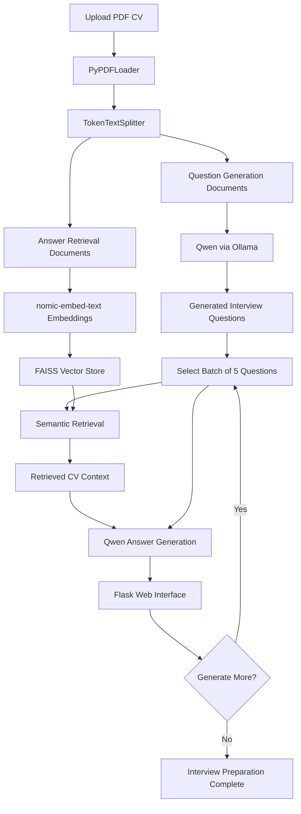

# AI Interview Questions Creator

### Personalized Interview Preparation Powered by Qwen, Ollama, LangChain & RAG

AI Interview Questions Creator is a local, AI-powered web application that generates personalized technical interview questions and suggested answers based on a candidate's uploaded CV.

Built with **Python, Flask, LangChain, FAISS, and Ollama**, the application combines Large Language Models (LLMs) with Retrieval-Augmented Generation (RAG) to provide context-aware interview preparation.

The application runs locally without requiring paid cloud APIs.

---

## Project Overview

Preparing for technical interviews can be challenging, especially when candidates need to connect their professional experience with role-specific questions.

This project automates part of that preparation by:

1. Extracting information from an uploaded PDF CV.
2. Generating personalized interview questions using Qwen.
3. Building a searchable representation of CV content.
4. Retrieving relevant information with FAISS.
5. Generating suggested interview answers using RAG.
6. Displaying results through an interactive Flask interface.

The system generates answers in batches of five questions to provide a more manageable user experience.

---

## Application Preview

### Home Page


### AI-Generated Interview Questions & Answers


### Additional Interview Questions


---

## Key Features

- **PDF CV Upload:** Upload a resume in PDF format.
- **Personalized Question Generation:** Generate questions based on the candidate's professional background.
- **Local LLM Integration:** Use Qwen through Ollama.
- **RAG-Powered Answers:** Retrieve relevant CV information before generating answers.
- **FAISS Vector Search:** Perform semantic similarity search over CV chunks.
- **Local Embeddings:** Generate embeddings using `nomic-embed-text`.
- **Batch Generation:** Generate and display answers in batches of five.
- **Markdown Support:** Display formatted AI-generated answers.
- **Responsive UI:** Dark-themed interface built with HTML and CSS.
- **Local Execution:** No paid LLM API required.

---

## Technology Stack

| Category                  | Technologies         |
| ------------------------- | -------------------- |
| Programming Language      | Python 3.12          |
| Backend                   | Flask                |
| LLM                       | Qwen 3 (4B Instruct) |
| Local Model Runtime       | Ollama               |
| LLM Framework             | LangChain            |
| Vector Database           | FAISS                |
| Embedding Model           | nomic-embed-text     |
| PDF Processing            | PyPDFLoader, PyPDF   |
| Text Splitting            | TokenTextSplitter    |
| Frontend                  | HTML, CSS, Jinja2    |
| Output Formatting         | Markdown, Bleach     |
| Environment Configuration | python-dotenv        |
| Version Control           | Git, GitHub          |

---

## System Architecture

The application separates interview question generation from RAG-based answer generation.



### Pipeline Overview

**Question Generation Pipeline**

PDF CV → Text Extraction → Text Splitting → LangChain Refine Chain → Qwen → Interview Questions

**Answer Generation Pipeline**

CV Documents → Embeddings → FAISS → Semantic Retrieval → Qwen → Generated Answers

Both pipelines use locally running models through Ollama.

---

## How RAG Works

The application uses Retrieval-Augmented Generation (RAG) to improve the relevance of generated answers by incorporating information retrieved from the uploaded CV.

### 1. Document Loading

`PyPDFLoader` extracts text from the uploaded PDF resume.

Each PDF page is represented as a LangChain Document.

### 2. Text Chunking

The extracted content is divided into chunks using `TokenTextSplitter`.

Different chunk sizes are used for different purposes:

**Question Generation**

- Chunk size: 10,000 tokens
- Chunk overlap: 200 tokens

**Answer Generation**

- Chunk size: 1,000 tokens
- Chunk overlap: 100 tokens

Larger chunks provide broader CV context for question generation, while smaller chunks support more focused retrieval.

### 3. Question Generation

The application uses Qwen through Ollama to generate personalized technical interview questions.

LangChain's `refine` summarization chain processes the CV context and generates interview questions.

Custom prompts help focus questions on the candidate's skills, education, projects, and professional experience.

### 4. Embedding Generation

The `nomic-embed-text` model converts CV text chunks into numerical vector representations.

These embeddings capture semantic information, allowing the system to find relevant content based on meaning rather than exact keyword matching.

### 5. Vector Storage

FAISS stores and indexes the document embeddings.

The vector store supports efficient similarity search over the candidate's CV content.

### 6. Context Retrieval

For each interview question, the application retrieves relevant CV chunks using a LangChain retriever.

The retriever is configured to return up to three relevant document chunks.

### 7. Answer Generation

The retrieved context and interview question are passed to Qwen.

The answer generation prompt instructs the model to:

- Use verified CV information for personal experience claims.
- Avoid inventing projects or achievements.
- Explain general technical concepts accurately.
- Clearly identify hypothetical examples.
- Generate concise, professional English answers.
- Use Markdown formatting when appropriate.

These instructions reduce the likelihood of unsupported claims but do not guarantee complete factual accuracy.

### 8. Batch Processing

The application generates and displays answers in batches of five questions.

The user can request additional answers by clicking **Generate 5 More Questions**.

This design reduces the initial generation workload and allows users to review questions progressively.

---

## Project Structure

```text
AI-Interview-Questions-Creator/
│
├── assets/
│   └── screenshots/
│       ├── 1.png
│       ├── 2.png
│       ├── 3.png
│       ├── 4.png
│       └── 5.png
│
├── src/
│   ├── __init__.py
│   ├── helper.py
│   └── prompt.py
│
├── static/
│   ├── docs/
│   ├── output/
│   └── style.css
│
├── templates/
│   └── index.html
│
├── app.py
├── requirements.txt
├── .gitignore
└── README.md
```

### Main Files

| File                   | Description                                                                       |
| ---------------------- | --------------------------------------------------------------------------------- |
| `app.py`               | Flask routes, file uploads, and interview session management                      |
| `src/helper.py`        | PDF processing, question generation, embeddings, retrieval, and answer generation |
| `src/prompt.py`        | Custom prompts for interview question generation                                  |
| `templates/index.html` | Main web application interface                                                    |
| `static/style.css`     | Responsive dark-themed styling                                                    |
| `requirements.txt`     | Python dependencies and pinned versions                                           |
| `.gitignore`           | Excludes sensitive and local development files                                    |
| `assets/screenshots/`  | Screenshots used for project documentation                                        |

**Privacy Note:** Personal CV files, uploaded documents, generated outputs, local environment variables, and development notebooks are excluded from the public repository.

---

## Installation

### Prerequisites

Before installing the application, ensure that you have:

- Python 3.12
- Git
- Ollama installed locally
- Sufficient RAM and disk space to run the required models

The application runs locally and does not require paid cloud LLM APIs.

### 1. Clone the Repository

```bash
git clone https://github.com/Maen-Qawasmeh/AI-Interview-Questions-Creator.git
cd AI-Interview-Questions-Creator
```

### 2. Create a Virtual Environment

```bash
python -m venv .venv
```

Activate the environment.

**Windows PowerShell:**

```powershell
.venv\Scripts\Activate.ps1
```

**Windows Git Bash:**

```bash
source .venv/Scripts/activate
```

**Linux / macOS:**

```bash
source .venv/bin/activate
```

### 3. Install Dependencies

```bash
python -m pip install -r requirements.txt
```

Check that the installed packages have no broken dependencies:

```bash
python -m pip check
```

### 4. Install and Prepare Ollama

Download and install Ollama:

https://ollama.com

Pull the required models:

**Language Model:**

```bash
ollama pull qwen3:4b-instruct
```

**Embedding Model:**

```bash
ollama pull nomic-embed-text
```

Verify the downloaded models:

```bash
ollama list
```

Make sure Ollama is running before launching the Flask application.

If Ollama is not already running, start its local server:

```bash
ollama serve
```

Depending on your operating system, Ollama may already be running as a background service.

### 5. Configure Environment Variables

Create a `.env` file in the project root directory.

Generate a secure Flask secret key:

```bash
python -c "import secrets; print(secrets.token_hex(32))"
```

Copy the generated key into your `.env` file:

```dotenv
FLASK_SECRET_KEY=your_generated_secret_key
```

Replace `your_generated_secret_key` with the generated value.

**Security Notes:**

- Never commit the `.env` file to GitHub.
- Do not share the Flask secret key.
- Use a unique secret key for each deployment.
- The `.gitignore` file excludes local environment configuration.

### 6. Run the Flask Application

Start the application:

```bash
python app.py
```

Open the following address in your browser:

http://127.0.0.1:5000

The application should display the AI Interview Questions Creator interface.

---

## How to Use

1. Start Ollama and ensure the required models are available.
2. Launch the Flask application.
3. Open the application in your browser.
4. Upload your CV in PDF format.
5. Click **Generate Interview Questions**.
6. Review the first five generated questions and suggested answers.
7. Click **Generate 5 More Questions** to generate the next batch.
8. Continue until all generated questions have been reviewed.
9. Adapt the suggested answers to reflect your actual experience.

**Note:** Generating answers may take additional time depending on available CPU, GPU, and memory resources.

---

## Local AI Models

The application uses two different local models.

### Qwen 3 — Language Model

**Model:** `qwen3:4b-instruct`

Used for:

- Generating personalized interview questions.
- Producing technical interview answers.
- Using retrieved CV context during answer generation.

### nomic-embed-text — Embedding Model

**Model:** `nomic-embed-text`

Used for:

- Converting CV document chunks into embeddings.
- Supporting semantic similarity search.
- Enabling FAISS-based retrieval.

This architecture separates language generation from document retrieval.

---

## Prompt Engineering

The application uses custom prompts to guide question and answer generation.

### Question Generation

Prompts focus on generating technical interview questions related to the candidate's documented:

- Programming skills.
- Data analysis experience.
- Machine learning knowledge.
- Deep learning knowledge.
- Software development background.
- Projects and professional experience.

### Answer Generation

The answer prompt emphasizes:

- Grounding personal claims in CV evidence.
- Avoiding fabricated achievements.
- Producing useful technical explanations.
- Distinguishing hypothetical examples from real experience.
- Keeping answers concise and interview-appropriate.

Prompt engineering helps guide the model's behavior but does not eliminate hallucinations.

---

## Limitations

The current application has several limitations:

- Only PDF resumes are supported.
- Ollama and the required models must be installed locally.
- Generation speed depends on the user's hardware.
- FAISS vector stores are currently rebuilt during answer generation.
- Generated answers may contain inaccuracies or unsupported statements.
- Interview sessions are stored in application memory and do not persist across server restarts.
- The application is designed for local development and demonstration.
- File-upload validation, session handling, request limits, and other safeguards would need further improvements for public deployment.
- Flask's development server is not intended for production hosting.

---

## Future Improvements

Planned improvements include:

- **Persistent Vector Storage:** Cache and reuse FAISS indexes.
- **Export Results:** Download questions and answers as PDF or CSV.
- **Job Description Integration:** Generate interview questions from a CV and a specific job posting.
- **Difficulty Levels:** Beginner, Intermediate, and Advanced.
- **Multiple LLM Options:** Support alternative local models.
- **Source Attribution:** Show which CV sections support each answer.
- **Answer Verification:** Improve detection of unsupported personal claims.
- **Mock Interview Mode:** Simulate interactive technical interviews.
- **Answer Evaluation:** Evaluate user-submitted interview responses.
- **Streaming Responses:** Display generated content progressively.
- **Production Readiness:** Improve security, session persistence, and deployment configuration.

---

## Development Workflow

This project was developed using Git and GitHub with a branch-based workflow.

Development updates were organized through feature and maintenance branches, reviewed using pull requests, and merged into the main branch.

The workflow includes:

1. Creating a dedicated branch.
2. Implementing and testing changes.
3. Committing changes with descriptive messages.
4. Pushing the branch to GitHub.
5. Opening a Pull Request.
6. Reviewing and merging changes.
7. Synchronizing the local repository.

---

## Author

**Maen Qawasmeh**

Computer Science Graduate | AI & Machine Learning Enthusiast

**Areas of Interest:**

Machine Learning • Deep Learning • Generative AI • NLP • RAG • LLM Applications

**Connect with me:**

[LinkedIn](https://www.linkedin.com/in/maen-qawasmeh-951ba0211/)

[GitHub Repository](https://github.com/Maen-Qawasmeh/AI-Interview-Questions-Creator)

---

## Disclaimer

This application is intended for educational purposes and technical interview preparation.

AI-generated answers should always be reviewed and adapted to reflect the candidate's actual experience, knowledge, skills, and achievements.

The application does not guarantee factual accuracy or interview success.
