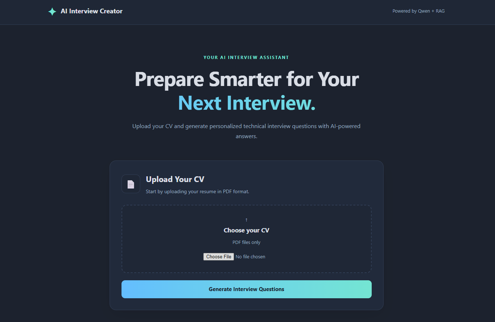
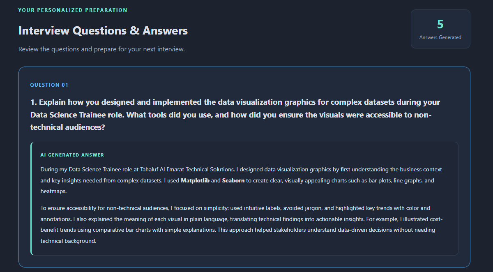
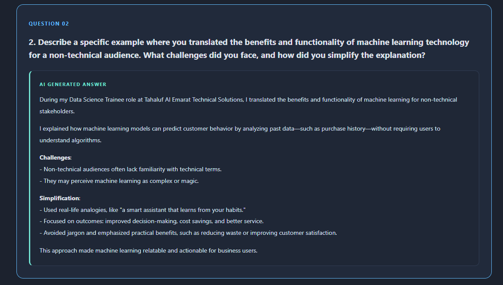
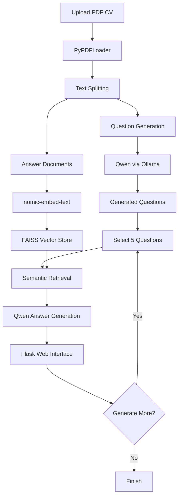

# AI Interview Questions Creator

### Personalized Interview Preparation Powered by Qwen, Ollama, LangChain & RAG

AI Interview Questions Creator is a local, AI-powered web application that generates personalized technical interview questions and suggested answers based on a candidate's uploaded CV.

Built with **Python, Flask, LangChain, FAISS, and Ollama**, the application combines Large Language Models (LLMs) with Retrieval-Augmented Generation (RAG) to provide context-aware interview preparation.

The application runs locally without requiring paid cloud APIs.

---

## Project Overview

Preparing for technical interviews can be challenging, especially when candidates need to connect their professional experience with role-specific questions.

This project automates part of that preparation by:

1. Extracting information from an uploaded PDF CV.
2. Generating personalized interview questions using Qwen.
3. Building a searchable representation of CV content.
4. Retrieving relevant information with FAISS.
5. Generating suggested interview answers using RAG.
6. Displaying results through an interactive Flask interface.

The system generates answers in batches of five questions to provide a more manageable user experience.

---

## Application Preview

### Home Page



### AI-Generated Interview Questions & Answers





### Additional Interview Questions


---

## Key Features

- **PDF CV Upload:** Upload a resume in PDF format.
- **Personalized Question Generation:** Generate questions based on the candidate's professional background.
- **Local LLM Integration:** Use Qwen through Ollama.
- **RAG-Powered Answers:** Retrieve relevant CV information before generating answers.
- **FAISS Vector Search:** Perform semantic similarity search over CV chunks.
- **Local Embeddings:** Generate embeddings using `nomic-embed-text`.
- **Batch Generation:** Generate and display answers in batches of five.
- **Markdown Support:** Display formatted AI-generated answers.
- **Responsive UI:** Dark-themed interface built with HTML and CSS.
- **Local Execution:** No paid LLM API required.

---

## Technology Stack

| Category | Technologies |
|----------|-------------|
| Programming Language | Python |
| Backend | Flask |
| LLM | Qwen 3 (4B Instruct) |
| Local Model Runtime | Ollama |
| LLM Framework | LangChain |
| Vector Database | FAISS |
| Embedding Model | nomic-embed-text |
| PDF Processing | PyPDFLoader, PyPDF |
| Text Splitting | TokenTextSplitter |
| Frontend | HTML, CSS, Jinja2 |
| Output Formatting | Markdown, Bleach |

---

## System Architecture



---

## How RAG Works

The application uses Retrieval-Augmented Generation to improve the relevance of generated answers.

### 1. Document Loading

`PyPDFLoader` extracts text from the uploaded resume.

### 2. Text Chunking

The extracted content is divided into chunks using `TokenTextSplitter`.

Larger chunks are used for question generation, while smaller chunks are used for retrieval during answer generation.

### 3. Embedding Generation

The `nomic-embed-text` model converts CV chunks into vector representations.

### 4. Vector Storage

FAISS indexes the embeddings for similarity search.

### 5. Context Retrieval

For each interview question, the retriever selects relevant CV chunks.

### 6. Answer Generation

Qwen receives the interview question and retrieved context to produce a suggested answer.

The system uses prompt instructions to discourage unsupported personal claims. However, generated answers may still contain inaccuracies and should be reviewed by the user.

---

## Project Structure

```text
AI-Interview-Questions-Creator/
│
├── assets/
│   └── screenshots/
│
├── src/
│   ├── __init__.py
│   ├── helper.py
│   └── prompt.py
│
├── static/
│   ├── docs/
│   ├── output/
│   └── style.css
│
├── templates/
│   └── index.html
│
├── app.py
├── requirements.txt
├── .gitignore
└── README.md
```

Uploaded documents, generated outputs, personal CVs, and local development notebooks are excluded from the public repository.

---

## Installation

### Prerequisites

- Python 3.12
- Ollama installed locally
- Git
- Sufficient RAM and disk space to run the local models

### 1. Clone the Repository

```bash
git clone https://github.com/YOUR_USERNAME/AI-Interview-Questions-Creator.git
cd AI-Interview-Questions-Creator
```

Replace `YOUR_USERNAME` with your GitHub username after creating the repository.

### 2. Create a Virtual Environment

```bash
python -m venv .venv
```

Activate the environment.

Windows PowerShell:

```powershell
.venv\Scripts\Activate.ps1
```

Windows Git Bash:

```bash
source .venv/Scripts/activate
```

### 3. Install Dependencies

```bash
python -m pip install -r requirements.txt
```

### 4. Install and Prepare Ollama

Download Ollama from:

https://ollama.com

Pull the required models:

```bash
ollama pull qwen3:4b-instruct
ollama pull nomic-embed-text
```

Make sure Ollama is running before starting the application.

### 5. Run the Flask Application

```bash
python app.py
```

Open the local address displayed by Flask, typically:

http://127.0.0.1:5000

---

## How to Use

1. Launch the Flask application.
2. Open the web interface in your browser.
3. Upload your CV as a PDF.
4. Click **Generate Interview Questions**.
5. Review the first five generated questions and answers.
6. Click **Generate 5 More Questions** to continue.
7. Use the generated content to prepare for technical interviews.

---

## Limitations

- The application currently supports PDF CVs.
- It requires locally installed Ollama models.
- Generation speed depends on available hardware.
- FAISS indexes are currently created during answer generation.
- Interview answers may contain inaccurate or unsupported statements.
- Flask's in-memory interview sessions are intended for local development, not production deployment.
- Public deployment would require additional security, session management, and file-upload safeguards.

---

## Future Improvements

- Persistent vector storage to avoid rebuilding embeddings.
- Export questions and answers as PDF or CSV.
- Support for job-description-based interview preparation.
- Interview difficulty selection.
- Additional LLM and embedding model options.
- Improved source attribution and factual verification.
- Mock interview mode with answer evaluation.
- Streaming LLM responses.

---

## Author

**Maen Qawasmeh**

Computer Science Graduate | AI & Machine Learning Enthusiast

[LinkedIn](https://www.linkedin.com/in/maen-qawasmeh-951ba0211/)

---

## Disclaimer

This application is intended for educational and interview preparation purposes.

AI-generated answers should be reviewed and adapted to reflect the candidate's actual experience, skills, and achievements.
